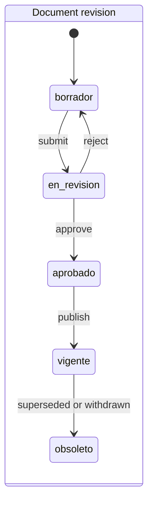
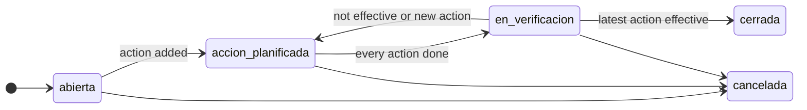
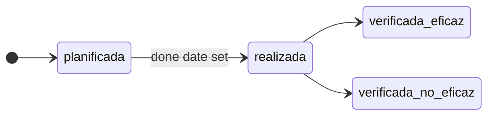

# Análisis de brechas ISO 9001 de la aplicación SGC

Este informe evalúa si la aplicación proporciona la información documentada y el soporte a los procesos que una organización necesita para demostrar cada requisito de ISO 9001 en una auditoría de certificación. Nació como punto de partida del trabajo de dominio previo al servidor MCP para agentes de IA, y ahora recoge lo que ese trabajo entregó y lo que queda pendiente.

- **Línea base (historial):** primera evaluación, de solo lectura, en `main@b794952` el 2026-10-02, incorporada al repositorio en `288558e`.
- **Reevaluación:** 2026-10-16, en `fd46fad` de la rama `docs/documentation-refresh`, cuyo código de aplicación coincide con `main`. Se volvieron a evaluar todas las filas de apartados.
- **Método:** revisión de solo lectura de los modelos, los servicios, la política de permisos, las rutas, las plantillas, el registro de módulos MCP, los informes y las tareas programadas. Las referencias a archivos y líneas apuntan a ese commit. El comportamiento se describe en la [guía de usuario](guia-de-usuario.md), la [capa de servicios](architecture/services.md) (en inglés) y el [servidor MCP](mcp.md).
- **Enfoque:** el software no puede cumplir ISO 9001; quien cumple es la organización. Cada apartado se juzga según si la aplicación puede conservar la evidencia y dar soporte al proceso.
- **Estado:** las fases 0 y 1 de la hoja de ruta están terminadas. Dieciséis de las 34 filas de apartados están ahora cubiertas, frente a ninguna en la línea base.

## Contenido

- [Resumen](#resumen)
- [Norma de referencia](#norma-de-referencia)
- [Defectos verificados](#defectos-verificados)
- [Evaluación apartado por apartado](#evaluación-apartado-por-apartado)
- [Las diez brechas principales por impacto en la auditoría](#las-diez-brechas-principales-por-impacto-en-la-auditoría)
- [Brechas transversales](#brechas-transversales)
- [Modelo de dominio objetivo](#modelo-de-dominio-objetivo)
  - [Entidades existentes que cambian](#entidades-existentes-que-cambian)
  - [Entidades nuevas](#entidades-nuevas)
  - [Máquinas de estado principales (tal como se entregaron)](#máquinas-de-estado-principales-tal-como-se-entregaron)
- [Fortalezas que conservar](#fortalezas-que-conservar)
- [Hoja de ruta propuesta](#hoja-de-ruta-propuesta)
- [Límites de este estudio](#límites-de-este-estudio)

## Resumen

**En la línea base, ningún apartado estaba cubierto por completo.** La aplicación era un conjunto de registros CRUD independientes. Sus entradas no estaban vinculadas, versionadas, aprobadas ni atribuidas a una persona.

**En la reevaluación, los apartados críticos para la auditoría están cubiertos:**

- información documentada: 7.5.1, 7.5.2 y 7.5.3;
- competencia: 7.2;
- riesgos y oportunidades: 6.1;
- sistema de gestión de la calidad y sus procesos: 4.4;
- roles, responsabilidades y autoridades: 5.3;
- objetivos de la calidad: 6.2;
- control de los procesos, productos y servicios suministrados externamente: 8.4;
- contexto de la organización, partes interesadas y alcance del SGC: 4.1, 4.2 y 4.3;
- seguimiento y medición: 9.1.1;
- auditoría interna: 9.2;
- revisión por la dirección: 9.3;
- no conformidad y acción correctiva: 10.2.

Cada entrada guarda quién la creó y quién la modificó por última vez, y queda en un registro de auditoría de solo inserción. En los registros que tocó la fase 1, las personas son entradas de un registro, no texto libre. Quedan abiertos los apartados de planificación y de operación, que siguen apoyándose en registros de texto sin cambios.

| Estado | Apartados en la reevaluación | En la línea base |
|---|---|---|
| Cubierto | 16 (4.1, 4.2, 4.3, 4.4, 5.3, 6.1, 6.2, 7.2, 7.5.1, 7.5.2, 7.5.3, 8.4, 9.1.1, 9.2, 9.3, 10.2) | 0 |
| Parcial | 11 | 22 |
| No cubierto | 6 (7.1.5, 7.1.6, 7.4, 8.3, 8.5, 8.6) | 8 |
| Solo soporte documental | 1 (5.1) | 4 |

La columna de la línea base recoge la evaluación original. La versión anterior de este documento mostraba un único apartado cubierto (9.3) porque solo se había actualizado esa fila.

Estos son los hallazgos que un auditor plantearía con más probabilidad en la reevaluación:

1. **6.1 Acciones para abordar riesgos y oportunidades:** resuelto el 17/10/2026. El registro era una lista de texto (tipo, descripción, plan), sin valoración, responsable, estado, fecha de revisión, vínculo con acciones ni pantalla web; ahora riesgos y oportunidades son registros separados con valoración, acciones y evaluación de su eficacia (véase la fila 6.1).
2. **4.4 Sistema de gestión de la calidad y sus procesos:** resuelto el 18/10/2026. Un proceso guardaba un nombre, un criterio de calidad y una marca de control de proveedores, sin responsable, entradas, salidas, interacciones ni pantalla web; ahora tiene tipo, responsable, entradas, salidas, recursos, criterios de operación y de aceptación, procesos relacionados y pantallas que muestran los registros que lo citan (véase la fila 4.4).
3. **8.4 Control de los procesos, productos y servicios suministrados externamente:** resuelto el 20/10/2026. La aplicación solo guardaba un booleano en el proceso y un origen de no conformidad, sin registro de proveedores, aprobación ni evaluación; ahora registra los proveedores con sus criterios de selección, sus procesos y un estado que decide un administrador, sus evaluaciones puntuadas con el resultado y la próxima evaluación, y las no conformidades que causan, con un PDF de proveedores aprobados y su desempeño entre las entradas de la revisión (véase la fila 8.4).
4. **6.3 Planificación de los cambios:** solo se siguen los cambios decididos en una revisión por la dirección, como acciones de revisión del tipo `cambio_sgc`.
5. **4.1 y 4.3, contexto y alcance:** resuelto el 23/10/2026. Solo podían conservarse como documentos controlados, sin registrar como datos las cuestiones externas e internas, la pertinencia del cambio climático ni las exclusiones justificadas; ahora las cuestiones son registros con su pertinencia y su marca climática, que los riesgos y las oportunidades citan, las partes interesadas tienen tipo, pertinencia, responsable, próxima revisión y requisitos climáticos, y el alcance se guarda por versiones aprobadas con la aplicabilidad justificada de cada requisito, en PDF y entre las entradas de la revisión (véanse las filas 4.1, 4.2 y 4.3).
6. **8.2 y 9.1.2, clientes:** los clientes son texto libre y las reclamaciones solo existen como no conformidades con origen `cliente`. No se registra ninguna revisión de los requisitos del cliente.

**Implicación para el trabajo MCP:**

- El servidor MCP está entregado: 28 módulos a través de cinco herramientas genéricas (`app/mcp_server/registry.py`, `_MODULES`). Cada registro de la fase 2 añade una entrada `Module` sobre su servicio.
- Los cuatro registros que solo tenían API JSON (roles, recursos de capacitación, procesos, indicadores de auditoría) tienen ahora pantallas web, siguen siendo módulos MCP y conservan sus endpoints JSON por compatibilidad.

## Norma de referencia

**ISO 9001:2026 se publicó el 2026-09-16** y sustituye a ISO 9001:2015 con la Modificación 1:2024. La tienda de AENOR incluye UNE-EN ISO 9001:2026. Las organizaciones certificadas disponen de una transición de tres años, hasta septiembre de 2029 aproximadamente.

> **Nota:** los datos de publicación y de transición proceden de fuentes secundarias (AFNOR, tienda de AENOR, publicaciones del sector). `[VERIFICAR: contrastar con iso.org y con el texto UNE antes de basarse en la redacción exacta de los apartados.]`

El estudio usó la estructura de apartados de la edición 2015 con la Modificación 1:2024. La edición 2026 mantiene los apartados 4 a 10, por lo que la evaluación sigue siendo válida. Estos cambios de 2026 afectan a la aplicación y deben incorporarse al diseño desde el principio:

| Tema | Cambio | Impacto en la aplicación |
|---|---|---|
| Riesgos y oportunidades (6.1) | Se tratan como conceptos separados, con más peso de las oportunidades | Separar `RiesgoOportunidad` en registros distintos de riesgo y de oportunidad (hecho: `Riesgo` y `Oportunidad`, 17/10/2026) |
| Planificación de los cambios (6.3) | Más planificación, comunicación, seguimiento y revisión de la eficacia de los cambios del SGC | `ChangeRecord` pasa a ser una prioridad, no un extra opcional (abierto) |
| Liderazgo y compromiso (5.1) | Promover la cultura de la calidad y el comportamiento ético | Soporte documental: registros de evidencia y confirmaciones de lectura (abierto) |
| Cambio climático (4.1, 4.2) | La Modificación 1:2024 se integra en el texto principal | Marca de pertinencia climática en las cuestiones de contexto y en los requisitos de las partes interesadas (hecho: `CuestionContexto.cambio_climatico` y `ParteInteresada.requisitos_climaticos`, 23/10/2026) |
| Revisión por la dirección (9.3) | Las entradas incluyen los cambios en las necesidades de las partes interesadas | Entregado: las entradas de la revisión enumeran las partes interesadas modificadas en el periodo (`app/services/management_reviews.py:727`, `_changed_parties`) |
| Información documentada (7.5) | La redacción pasa de «mantener» a «disponible como información documentada» | No se prevé ningún cambio de modelo |

## Defectos verificados

Cada uno de estos defectos se confirmó leyendo el código.

- **Defectos de la línea base:** los dos primeros los detectó la auditoría de errores de septiembre de 2026. La fase 0 corrigió los tres.
- **Defectos encontrados al redactar las guías de usuario:** los cuatro últimos. Se corrigieron el 16/10/2026, después de la reevaluación (`odd/tasks/documented-defects.md`).

| Defecto | Ubicación | Efecto | Estado |
|---|---|---|---|
| El informe mensual cuenta totales históricos | `app/utils/reports.py:95-147`, `_monthly_report_context` | Ahora los recuentos filtran por el mes natural de `fecha` | Corregido |
| El gráfico de satisfacción mezcla años | `app/routes/dashboard_routes.py:87-96` | Ahora se agrupa por año y mes en los últimos 12 meses | Corregido |
| Cualquier usuario autenticado puede borrar una no conformidad | `app/services/nonconformities.py:517-522`, `delete` | Ahora exige el permiso de borrado, que solo tiene ADMINISTRADOR (`app/services/policy.py:117`). El borrado deja una instantánea en el registro de auditoría | Corregido |
| El panel de control muestra datos de auditorías a todos los roles | `app/routes/dashboard_routes.py`, `dashboard`; `app/services/audits.py`, `upcoming`; `app/templates/dashboard/dashboard.html` | Ahora el número de auditorías y la tarjeta de próximas auditorías solo se calculan y muestran a quien puede leer auditorías (`can('read', 'audits')`), y la tarjeta solo lista las auditorías pendientes de celebrar de los próximos siete días (`audits.upcoming`, `app/services/audits.py`). Afectaba a 7.5.3 y 9.2 | Corregido |
| La sesión no tenía límites propios de inactividad ni de duración | `app/session_lifetime.py`, `enforce`; `app/routes/auth_routes.py`, `login`; `app/config.py`, `Config` | Ahora la cookie de sesión sigue terminando al cerrar el navegador y, además, el servidor cierra la sesión tras 8 horas sin actividad (`SESSION_IDLE_TIMEOUT`) o 12 horas después de iniciarla (`SESSION_ABSOLUTE_LIFETIME`), a partir de las horas guardadas en la sesión firmada, con el aviso «La sesión ha caducado». Se eliminaron los ajustes `REMEMBER_COOKIE_*`, que no se usaban, porque no se ofrece «recordarme». Afectaba a 7.5.3 | Corregido |
| El informe mensual se fecha con el último día del mes | `app/utils/reports.py`, `_monthly_report_context`; `app/audit_notifications.py`, `send_monthly_quality_report` | Ahora «Generado el» muestra el día en que se genera el informe y la cabecera indica el periodo, en el PDF y en el correo programado (`_monthly_report_context`). Afectaba a 7.5.2 y 9.1.1 | Corregido |
| El límite de enlaces de restablecimiento cuenta por dirección de red | `app/routes/user_routes.py`, `send_reset_link` | Ahora el límite de 10 enlaces por hora cuenta por administrador, no por dirección de red | Corregido |

## Evaluación apartado por apartado

Leyenda (cada letra es la inicial del estado: C de cubierto, P de parcial, N de no cubierto y D de documental):

- **C** (cubierto): registros estructurados conservan la evidencia y los servicios hacen cumplir el proceso.
- **P** (parcial): algún soporte estructurado, o solo texto libre que la organización debe completar.
- **N** (no cubierto).
- **D** (solo soporte documental): la organización puede conservar un documento controlado (7.5), pero la aplicación no tiene registros para ello.

«(antes X)» marca un estado que ha cambiado desde la línea base. Las rutas son relativas a `app/`. Los títulos de los apartados siguen la versión española de la norma (UNE-EN ISO 9001).

| Apartado | Estado | Evidencia | Brecha |
|---|---|---|---|
| 4.1 Comprensión de la organización y de su contexto | **C** (antes D) | Registro de cuestiones externas e internas (`CuestionContexto`, `models.py`) con tipo, categoría según el tipo (`CATEGORIAS_POR_TIPO`), descripción, efecto, pertinencia con su justificación, marca de cambio climático, responsable, fecha de identificación, próxima revisión y estado vigente o superada (reglas en `services/context_issues.py`, `issues`, `CATEGORY_MISMATCH`, `JUSTIFICATION_REQUIRED`). Los riesgos y las oportunidades citan la cuestión de la que nacen (`Riesgo.cuestion_id` y `Oportunidad.cuestion_id`; `services/risks.py`, `ISSUE_SUPERSEDED`). Revisiones vencidas en el panel de control (`services/context_issues.py`, `attention`). Pantallas web (`routes/context_routes.py`) y módulo MCP `cuestiones_contexto` (`mcp_server/registry.py`, `_context_modules`). Las cuestiones nuevas, modificadas y superadas en el periodo, con los recuentos de pertinentes y relacionadas con el cambio climático, son entrada de la revisión (`services/context_issues.py`, `changes`; `services/management_reviews.py`, `_context_issues`), con el comentario `comentario_contexto` (`models.py`, `RevisionDireccion`) | Menor: no se guarda la fecha en que una cuestión se supera (cuenta su última modificación) ni el historial de su pertinencia, salvo en el registro de auditoría |
| 4.2 Comprensión de las necesidades y expectativas de las partes interesadas | **C** (antes P) | `ParteInteresada` (`models.py`) con tipo, pertinencia (o sin evaluar), responsable, próxima revisión y marca de requisitos relacionados con el cambio climático, además de las necesidades y expectativas, los requisitos y el objetivo estratégico; una próxima revisión nueva nunca es anterior a hoy (`services/stakeholders.py`, `REVIEW_IN_PAST`). Pantallas web con la página de cada parte (`routes/parte_interesada_routes.py`), revisiones vencidas en el panel de control (`services/context_issues.py`, `attention`) y el módulo MCP `partes_interesadas`. Los riesgos y las oportunidades citan la parte interesada (`parte_interesada_id`). Las partes modificadas en el periodo de una revisión figuran entre las entradas de la revisión (`services/management_reviews.py`, `_changed_parties`) | Menor: las necesidades, las expectativas y los requisitos siguen siendo texto libre, sin un registro por requisito ni su seguimiento |
| 4.3 Determinación del alcance del sistema de gestión de la calidad | **C** (antes D) | Alcance del SGC por versiones (`AlcanceSGC`, `models.py`) con la declaración, los productos y servicios, los centros y la aplicabilidad de cada uno de los 38 requisitos del catálogo, de 4.1 a 10.3 (`aplicabilidad_alcance`; `services/qms_scope.py`, `CATALOGUE`), con justificación obligatoria de los que no aplican (`JUSTIFICATION_REQUIRED`). Estados borrador, vigente y obsoleto; aprueba un administrador, con su persona y la fecha (`services/qms_scope.py`, `approve`), y las versiones aprobadas no cambian (`IMMUTABLE`). Pantallas web con el historial y un PDF por versión que repite al final los requisitos que no aplican (`routes/scope_routes.py`, `export_pdf`, `export_version_pdf`); módulo MCP `alcances_sgc`, que solo escribe borradores. La versión vigente y su fecha de aprobación son entrada de la revisión (`services/management_reviews.py`, `_scope_in_force`) | Menor: el alcance no está vinculado a los procesos ni a los documentos; los productos y servicios y los centros son texto libre |
| 4.4 Sistema de gestión de la calidad y sus procesos | **C** (antes P) | `ProcesoOperacion` (`models.py`) guarda el tipo (`TipoProceso`), el responsable (`responsable_id`, una persona), las entradas, las salidas, los recursos, los criterios de operación (`criterio_calidad`) y de aceptación (`criterios_aceptacion`), y sus interacciones como relaciones mutuas (`proceso_relaciones`; `services/process_operations.py`, `related_ids`). Los objetivos de la calidad, que son los indicadores del proceso, y los riesgos y oportunidades citan procesos (`ObjetivoCalidad.proceso_id`; `Riesgo` y `Oportunidad`, `proceso_id`; `services/process_operations.py`, `cited_by`). Pantallas web con la lista filtrable y la página de cada proceso con sus procesos relacionados y los registros que lo citan (`routes/process_role_routes.py`, `list_processes`, `show_process`); módulo MCP `procesos` (`mcp_server/registry.py`, `_process_extras`) | Menor: las entradas, las salidas, los recursos y los criterios son texto libre, y las relaciones no registran la secuencia. Las no conformidades no están vinculadas a procesos, y un proceso no cita su información documentada |
| 5.1 Liderazgo y compromiso | D | Las revisiones por la dirección registran asistentes, conclusiones y acciones (`RevisionDireccion`, `models.py:984-1044`). Marca `RolResponsabilidad.compromiso_calidad` (`models.py:107`) | Nada identifica a la alta dirección. No hay registros de evidencia del compromiso, la cultura de la calidad ni la ética (2026) |
| 5.2 Política | P | La política puede ser un documento controlado: revisiones numeradas, aprobación por alguien distinto del autor, fecha de entrada en vigor e historial (`services/document_revisions.py:255-335`). Todos los roles leen la revisión vigente (`services/policy.py:126`; `DRAFT_READERS`, `services/document_revisions.py:83`). Texto libre heredado `RolResponsabilidad.descripcion_politica_calidad` (`models.py:108`) | No se registra que las personas hayan leído o confirmado la política. No hay categoría de política de la calidad (`DocumentCategory`, `models.py:1089-1100`). La política no está disponible para las partes interesadas externas a través de la aplicación |
| 5.3 Roles, responsabilidades y autoridades en la organización | **C** (antes P) | Cada rol guarda sus responsabilidades, sus autoridades y el rol al que reporta, sin ciclos (`RolResponsabilidad`, `models.py`; `services/roles_responsibilities.py`, `REPORTING_CYCLE`). Las personas desempeñan roles del SGC (`persona_roles` y `Person`, `models.py`) y los roles llevan requisitos de competencia (`CompetenceRequirement`, `models.py`). Pantallas web con la línea de reporte hasta la cúspide, los roles que le reportan, las personas que lo desempeñan y su competencia requerida (`routes/process_role_routes.py`, `show_role`; `services/roles_responsibilities.py`, `holders`); módulo MCP `roles_responsabilidades`. Cada proceso tiene una persona responsable (`ProcesoOperacion.responsable_id`). Una persona puede estar vinculada a un usuario de acceso (`Person.user_id`, `models.py`) | Menor: las responsabilidades y las autoridades son texto libre, y no se registra que se hayan comunicado y entendido. Los roles no están vinculados a procesos: el responsable de un proceso es una persona |
| 6.1 Acciones para abordar riesgos y oportunidades | **C** (antes P) | Registros separados de riesgos y de oportunidades (`Riesgo` y `Oportunidad`, `models.py`) con origen interno o externo, parte interesada, cuestión del contexto, proceso, responsable, estado, fecha de identificación y próxima revisión. Valoración por probabilidad e impacto (`models.py`, `nivel`) y por beneficio y viabilidad (`prioridad`), con tratamiento o decisión y la valoración residual del riesgo. Acciones con responsable, fecha límite, estado y evaluación de la eficacia una vez completadas (`AccionRiesgo`, `models.py`; reglas en `services/risks.py`, `actions`). Revisiones vencidas (`services/risks.py`, `revision_vencida`) y avisos del panel de control (`attention`). Pantallas web con mapa de calor y un PDF por registro (`routes/risk_routes.py`, `RISKS`, `OPPORTUNITIES`, `_export_pdf`); módulos MCP `riesgos`, `oportunidades` y `acciones_riesgo` (`mcp_server/registry.py`, `_risk_modules`). Las entradas de la revisión cuentan los riesgos por nivel y las oportunidades por prioridad (`services/management_reviews.py`, `_risks`, `_opportunities`), con el comentario `comentario_riesgos` (`models.py`, `RevisionDireccion`) | Menor: la revisión por la dirección no resume la eficacia de las acciones (9.3.2 e), que cubre el comentario. Las no conformidades no citan riesgos (10.2.1 e) |
| 6.2 Objetivos de la calidad y planificación para lograrlos | **C** (antes P) | `ObjetivoCalidad` (`models.py:835-886`) tiene título, indicador, unidad, meta y sentido, valor inicial, responsable, periodo, frecuencia, recursos, método de evaluación y estado. Las mediciones son registros propios (`MedicionObjetivo`, `models.py:889-917`). La meta queda fijada en cuanto hay mediciones, y el avance, la tendencia y los retrasos se calculan en `services/quality_objectives.py` (`summary` en `:466`, `off_track` en `:519`). Todos los roles leen los objetivos (`services/policy.py:139`). Pantallas web, un PDF anual (`routes/quality_objective_routes.py:234`) y una tarjeta en el panel de control | Menor: «qué se va a hacer» (6.2.2 a) es texto libre (`descripcion`), no acciones con seguimiento. Sin vínculo con la política ni con los riesgos |
| 6.3 Planificación de los cambios | P (antes N) | Una revisión por la dirección puede registrar un cambio en el SGC como acción del tipo `cambio_sgc` (`TipoAccionRevision`, `models.py:931-936`), con responsable, plazo, estado y resultado (`AccionRevision`, `models.py:1047-1086`) | No hay registro de cambios fuera de las revisiones por la dirección. No se registran el propósito, las consecuencias, la integridad, los recursos ni la eficacia de un cambio |
| 7.1 Recursos | P | `RecursoCapacitacion` (`models.py`) con pantallas web (`routes/register_routes.py`, `list_resources`) y el módulo MCP `recursos_capacitacion`. Los recursos de cada proceso, en texto (`ProcesoOperacion.recursos`). Registro de personas (7.1.2, `Person`). Comentario de la revisión `comentario_recursos` y acciones del tipo `recursos` (`models.py:1019`, `:936`) | Sin registros de infraestructura (7.1.3) ni de ambiente para la operación de los procesos (7.1.4). El registro de recursos de capacitación no tiene tipo, responsable ni estado |
| 7.1.5 Recursos de seguimiento y medición | N | Ninguna | Sin registro de equipos ni registros de calibración |
| 7.1.6 Conocimientos de la organización | N | Ninguna | Sin registro de conocimientos ni de lecciones aprendidas |
| 7.2 Competencia | **C** (antes P) | Competencia requerida por rol (`CompetenceRequirement`, `models.py:409-429`). Competencia demostrada por persona, con evidencia, caducidad, vínculo con la capacitación y una evaluación de la eficacia hecha por otra persona (`CompetenceRecord`, `models.py:432-487`). Matriz de competencia requerida frente a demostrada (`services/competence.py:344`, `cell_status`; `:375`, `matrix`; página `routes/competence_routes.py:141`). La capacitación está vinculada a una persona (`Capacitacion.persona_id`, `models.py:634`) | Menor: la evidencia es un texto o una referencia (500 caracteres), sin carga de certificados. El campo `evaluacion_final` de la propia capacitación es texto libre |
| 7.3 Toma de conciencia | P (antes D) | Todos los roles leen los documentos vigentes y los objetivos de la calidad (`services/policy.py:126`, `:139`). Las sesiones de sensibilización pueden registrarse como capacitación (`Capacitacion`) | No se registra la confirmación de que una persona ha leído la política, los objetivos o un procedimiento |
| 7.4 Comunicación | N | Solo correos automáticos: recordatorios de auditoría, avisos de revisión de documentos y el informe mensual (`audit_notifications.py:55`, `:81`, `:112`, `:140`) | Sin plan de comunicación: qué, cuándo, a quién, cómo y quién comunica |
| 7.5.1 Información documentada: generalidades | **C** (antes P) | Documentos controlados (`Document`, `models.py:1102-1123`) con revisiones numeradas (`DocumentRevision`, `models.py:1153-1216`). Todos los registros guardan quién creó y quién modificó cada entrada (`RecordMetadataMixin`, `models.py:57-90`), y un registro de auditoría de solo inserción conserva el historial (`AuditLog`, `models.py:1220-1258`) | Ninguna para el apartado en sí. Los registros parciales se evalúan en sus propios apartados |
| 7.5.2 Creación y actualización | **C** (antes P) | Identificación: código, título, categoría, número de revisión y autor (`models.py:1113-1115`, `:1191`, `:1200`). Para enviar a revisión hace falta un resumen del cambio (`models.py:1199`). Revisión y aprobación: enviar, aprobar (ADMINISTRADOR, nunca el autor) y rechazar con un motivo (`services/document_revisions.py:255-299`). Formato: texto más un PDF, DOCX, XLSX u ODT opcional, comprobado por su contenido (`services/document_files.py:60-64`, `:155`) | Ninguna |
| 7.5.3 Control de la información documentada | **C** (antes N) | Como máximo, una revisión vigente y una en preparación (`models.py:1140-1142`, `:1181-1184`). Publicar deja obsoleta la revisión anterior (`services/document_revisions.py:300`). Las revisiones vigentes u obsoletas no cambian nunca (`IMMUTABLE`, `:94`). Retirada en lugar de borrado (`:313`). Solo ADMINISTRADOR y AUDITOR pueden leer los borradores (`:83`). Fecha de la próxima revisión y aviso semanal a los responsables (`services/documents.py:173`; `audit_notifications.py:140`). Suma de comprobación de los adjuntos (`models.py:1212`). Registro de auditoría de solo inserción (`services/audit.py:183-190`) | Sin periodo de conservación ni registro de disposición. Sin marca de origen externo. Los administradores aún pueden borrar definitivamente las entradas de los registros antiguos (queda una instantánea en el registro de auditoría). Sin pantalla para consultar el registro de auditoría |
| 8.1 Planificación y control operacional | P | Cada proceso guarda sus criterios de operación (`ProcesoOperacion.criterio_calidad`), los criterios de aceptación de sus salidas (`criterios_aceptacion`), sus entradas, salidas y recursos (`models.py`, `ProcesoOperacion`), con pantallas web (`routes/process_role_routes.py`, `show_process`; `forms.py`, `ProcesoForm`) y el módulo MCP `procesos` | Sin plan operacional ni registros que demuestren que los procesos se llevan a cabo según sus criterios. Los cambios planificados (6.3) no tienen control propio; los procesos contratados externamente se controlan en el registro de proveedores (8.4) |
| 8.2 Requisitos para los productos y servicios | P | Retroalimentación de los clientes en `SatisfaccionCliente` (`models.py:619-625`). Las reclamaciones pueden registrarse como no conformidades con origen `cliente` (`OrigenNoConformidad`, `models.py:508`) | Sin revisión de los requisitos del cliente, sin registro de cambios ni de comunicaciones, y sin registro de reclamaciones con la respuesta al cliente |
| 8.3 Diseño y desarrollo de los productos y servicios | N | Ninguna | No existe una entidad de diseño; solo puede excluirse si la organización lo justifica |
| 8.4 Control de los procesos, productos y servicios suministrados externamente | **C** (antes P) | Registro de proveedores (`Proveedor`, `models.py`) con NIF, contacto, tipo de suministro, lo que suministra, los procesos afectados (`proveedor_procesos`), los criterios de selección (`criterios_seleccion`) y la próxima evaluación. Su estado (`pendiente`, `aprobado`, `condicionado`, `bloqueado`) solo cambia por la decisión de un administrador, con fecha, persona y motivo (`services/providers.py`, `approve`, `condition`, `block`; restricción `ck_proveedores_decision`). Evaluaciones puntuadas de calidad, plazo, servicio y documentación, con su resultado (`EvaluacionProveedor`, `models.py`; `services/providers.py`, `puntuacion`, `resultado`). Reevaluación: la próxima evaluación sigue a la última evaluación y las vencidas se señalan (`services/providers.py`, `evaluacion_vencida`, `attention`). Las no conformidades con origen `proveedor` citan al proveedor (`NoConformidad.proveedor_id`). Pantallas web, tarjeta del panel y PDF de proveedores aprobados (`routes/provider_routes.py`, `show_provider`, `export_pdf`); módulos MCP `proveedores` y `evaluaciones_proveedor` (`mcp_server/registry.py`, `_provider_modules`). Su desempeño figura entre las entradas de la revisión (`services/management_reviews.py`, `_providers`) | Menor: no se registra la información comunicada a los proveedores (8.4.3) ni la verificación de lo que suministran (8.4.2 d). El historial de los estados solo queda en el registro de auditoría, y `ProcesoOperacion.control_proveedor` sigue siendo una marca |
| 8.5 Producción y provisión del servicio | N | Ninguna | Sin registros de control, trazabilidad, propiedad perteneciente al cliente ni actividades posteriores a la entrega |
| 8.6 Liberación de los productos y servicios | N | Ninguna | Sin registro de liberación |
| 8.7 Control de las salidas no conformes | P | `NoConformidad` (`models.py:523-542`) con origen, gravedad, contención (`contencion`), responsable (`responsable_id`) y causa raíz, y acciones correctivas (10.2) | Sin tratamiento (corrección, separación, devolución, concesión), sin registro de la concesión ni de la autoridad que decide, y sin vínculo con el producto, el lote o el proceso |
| 9.1.1 Seguimiento, medición, análisis y evaluación: generalidades | **C** (antes P) | Los indicadores son registros: cada objetivo define qué se mide, con qué frecuencia y cómo se evalúan los resultados (`models.py:864-877`). Las mediciones fechadas (`models.py:889-917`) se comparan con la meta, con comprobación de la tendencia y de los retrasos (`services/quality_objectives.py:466`). El informe mensual cuenta los datos del mes y valora los objetivos (`utils/reports.py:66`, `:95-147`) | Menor: los indicadores de proceso sin meta deben darse de alta como objetivos. El registro heredado de indicadores de auditoría (`AuditoriaIndicador`) sigue siendo texto libre; su lista web remite los indicadores nuevos de los procesos a los objetivos de la calidad (`routes/register_routes.py`, `list_indicators`) |
| 9.1.2 Satisfacción del cliente | P | `SatisfaccionCliente` (`models.py:619-625`) con pantallas web (`routes/satisfaccion_cliente_routes.py`) y un PDF. Media del periodo entre las entradas de la revisión (`services/management_reviews.py:753`). Gráfico mensual (`routes/dashboard_routes.py:87-96`) | El cliente es texto libre. Sin tipo de encuesta, canal ni meta |
| 9.1.3 Análisis y evaluación | P | Objetivo frente a meta y tendencia (`services/quality_objectives.py:466`, `:519`). Entradas de la revisión acotadas al periodo: satisfacción, objetivos, indicadores, no conformidades, auditorías, mejoras, capacitación y proveedores externos (`services/management_reviews.py`, `inputs`). Desempeño de los proveedores externos (9.1.3 f): de cada proveedor, la puntuación media, el último resultado y sus no conformidades (`services/providers.py`, `performances`); en la revisión, las evaluaciones del periodo por resultado, los proveedores no aptos y las no conformidades por proveedor (`services/management_reviews.py`, `_providers`). Informe mensual | Sin un análisis conjunto de la eficacia de las acciones tomadas para abordar los riesgos (9.1.3 e): cada acción registra la suya (`AccionRiesgo.eficacia`), pero ni la revisión ni el informe la resumen. Sin datos de la conformidad de los productos y servicios (9.1.3 a), que no tienen registros (8.6) |
| 9.2 Auditoría interna | **C** (antes P) | Programa anual con objetivos y alcance, aprobado por un administrador (`ProgramaAuditoria`, `models.py:662-696`; `services/audit_programmes.py:187`). Cada auditoría tiene programa, alcance, criterios, auditor jefe, equipo y responsable del área (`Auditoria` y `auditoria_equipo`, `models.py:701-762`). Comprobación de independencia: ningún auditor es responsable del área auditada (`services/audits.py:226-251`). Los hallazgos se clasifican y un hallazgo de no conformidad abre su no conformidad (`HallazgoAuditoria`, `models.py:765-807`; `services/audit_findings.py:277`). PDF de la auditoría y del programa (`routes/auditoria_routes.py:306`; `routes/audit_programme_routes.py:139`). Recordatorios (`audit_notifications.py:55`, `:81`) | Menor: el informe de auditoría es texto libre (`resultado`) y `accion_correctiva` es texto libre heredado. Sin frecuencia ni método de auditoría por proceso |
| 9.3 Revisión por la dirección | C | Cada revisión registra la fecha de la reunión, el periodo, los asistentes, un comentario por cada entrada de 9.3.2 y las conclusiones (`RevisionDireccion`, `models.py:984-1044`). Las entradas se obtienen de los registros y se congelan al celebrar la revisión (`services/management_reviews.py:595`, `inputs`; `:355`, `hold`). Cada salida es una acción con responsable, plazo y seguimiento (`AccionRevision`, `models.py:1047-1086`). PDF del acta (`routes/management_review_routes.py:310`) y una tarjeta de acciones vencidas | Ninguna |
| 10.1 Mejora: generalidades | P | `Mejora` (`models.py:147-153`) con pantallas web (`routes/mejora_routes.py`). También surgen oportunidades de los hallazgos de auditoría del tipo `oportunidad_mejora` y de las acciones de revisión del tipo `mejora` (`models.py:771`, `:934`) | Las mejoras son una lista de texto libre que exige un texto de no conformidad (`forms.py:172-176`). Sin flujo de tratamiento ni vínculo con su origen. Las oportunidades están en tres lugares sin conexión |
| 10.2 No conformidad y acción correctiva | **C** (antes P) | `NoConformidad` (`models.py:490-542`) tiene origen, gravedad, contención, causa raíz, responsable y un estado que solo fija el servicio. Las acciones correctivas tienen responsable, fecha límite, fecha de realización y verificación por alguien distinto del responsable (`AccionCorrectiva`, `models.py:545-616`; `services/corrective_actions.py:231`, `verify`). Una no conformidad solo se cierra cuando su última acción resulta eficaz (`services/nonconformities.py:378`, `close`; `:450`, `close_blockers`). Cancelar y reabrir con un motivo; PDF (`routes/no_conformidad_routes.py:210`) | Menor: sin vínculo con los riesgos (10.2.1 e) ni con los cambios del SGC (10.2.1 f), y sin registro de no conformidades similares. El texto libre heredado `accion_correctiva` sigue siendo editable en el formulario (`forms.py:143`) |
| 10.3 Mejora continua | P | `Mejora` (`models.py:147-153`). Tendencias de los objetivos (`services/quality_objectives.py:466`). Conclusiones de la revisión y acciones de mejora (`models.py:1022`, `:934`) | `fecha_implementacion` es siempre el momento de creación (`models.py:153`; no figura en el formulario). Las mejoras no están vinculadas a los objetivos ni a las salidas de la revisión |

## Las diez brechas principales por impacto en la auditoría

La fase 1 cerró las siete primeras brechas de la línea base:

- documentos no controlados;
- ausencia de revisión por la dirección;
- el ciclo de la acción correctiva sin cerrar;
- ausencia de programa de auditoría;
- objetivos no medibles;
- sin atribución ni historial;
- personas como texto libre.

Estas son las diez que quedan.

| # | Brecha | Apartado | Por qué la señala un auditor | Cambio de dominio |
|---|---|---|---|---|
| 1 | Riesgos y oportunidades sin estructura (resuelto el 17/10/2026) | 6.1 | Apartado de planificación obligatorio, modificado en 2026, sin valoración, responsable, estado, revisión ni acciones | Registros separados de riesgo y de oportunidad con valoración, responsable, fecha de revisión y vínculos con acciones, procesos y contexto; pantallas web |
| 2 | Procesos y roles sin definir (resuelto el 18/10/2026, salvo el vínculo de las no conformidades con los procesos) | 4.4, 8.1, 5.3 | Sin responsable de proceso, entradas, salidas ni interacciones. Los roles no recogen responsabilidades ni autoridades. Ninguno de los dos tiene pantalla web | Responsable, entradas, salidas, interacciones y criterios en `ProcesoOperacion`; responsabilidades y autoridades en los roles; pantallas; no conformidades, riesgos y objetivos vinculados a procesos |
| 3 | Sin control de proveedores (resuelto el 20/10/2026) | 8.4 | Solo un booleano y un origen de no conformidad | `Supplier`, `SupplierEvaluation`, estado de proveedor aprobado, vínculos desde las no conformidades con origen `proveedor` |
| 4 | Contexto y alcance sin registrar (resuelto el 23/10/2026) | 4.1, 4.2, 4.3 | Las cuestiones, la pertinencia del cambio climático, los requisitos de las partes interesadas y las exclusiones existen, como mucho, en un documento | `ContextIssue` con marca climática, `InterestedPartyRequirement`, un registro del alcance y las exclusiones, todo ello como entrada de la revisión |
| 5 | Sin registro de cambios | 6.3 | Reforzado en 2026; solo acciones de revisión del tipo `cambio_sgc` | `ChangeRecord` con propósito, consecuencias, recursos, responsable y revisión de la eficacia |
| 6 | Clientes como texto libre y reclamaciones solo como no conformidades | 8.2, 9.1.2 | El mismo cliente aparece con varias grafías; sin tratamiento de reclamaciones ni revisión de requisitos | `Customer`, `Complaint` con vínculo opcional a una no conformidad, tipo de encuesta y canal |
| 7 | Salidas no conformes sin tratamiento | 8.7 | Sin tratamiento, concesión ni autoridad que decide; sin vínculo con el producto o el proceso | Tratamiento, concesión y autoridad en `NoConformidad`, más un vínculo con el proceso |
| 8 | Sin registro de calibración | 7.1.5 | Obligatorio allí donde se usan resultados de medición | `MeasuringEquipment`, `CalibrationRecord` |
| 9 | Política y objetivos sin confirmación de lectura | 5.2, 7.3 | La toma de conciencia se apoya solo en entrevistas | Confirmaciones de lectura de la revisión vigente de la política y de los objetivos |
| 10 | Sin plan de comunicación ni registro de conocimientos | 7.4, 7.1.6 | Nada registra qué se comunica ni a quién, ni las lecciones aprendidas | `CommunicationPlan`, un registro de conocimientos o de lecciones aprendidas |

## Brechas transversales

- **Vínculos que aún faltan.**
  - Entregados: no conformidad → acción correctiva → eficacia; hallazgo de auditoría → no conformidad; objetivo → proceso; revisión → acciones; no conformidad → proveedor.
  - Aún pendientes: reclamación → no conformidad; no conformidad → proceso; mejora → su origen.
  - Los clientes siguen siendo texto libre; los proveedores ya son un registro (8.4).
- **Sin tratamiento de reclamaciones.** Las reclamaciones solo existen como no conformidades con origen `cliente`, junto a las encuestas de satisfacción.
- **Roles poco granulares.**
  - El acceso sigue una matriz por recurso (`services/policy.py:117-141`) sobre tres roles.
  - Ningún rol distingue a quienes aprueban ni a la alta dirección. Las aprobaciones recaen en ADMINISTRADOR, con la regla «nunca el autor» para los documentos (`services/document_revisions.py:266-286`).
- **El registro de auditoría no puede consultarse en la aplicación.** Todos los modelos se auditan (`services/audit.py:45`, `AUDITED_MODELS`) y las filas son de solo inserción (`:183-190`). Sin embargo, el registro solo tiene una entrada en la política de permisos (`policy.py:133`): ni pantalla ni módulo MCP. El historial debe mostrarse a un auditor desde la base de datos.
- **Siguen existiendo borrados definitivos** en los registros antiguos. Están limitados a los administradores y dejan una instantánea completa en el registro de auditoría, pero eliminan la propia entrada.

## Modelo de dominio objetivo

Esta era la propuesta de la línea base. La columna de estado recoge lo que entregaron las fases 0 y 1; los nombres de campo de las entidades abiertas son orientativos.

### Entidades existentes que cambian

| Entidad | Cambios | En la reevaluación |
|---|---|---|
| `User` | Vínculo con `Person`; `active`, `last_login` | Hecho salvo `last_login`: `Person.user_id` (`models.py:343`), `User.active` (`models.py:164`) |
| `Document` | `status`, `owner_id`, `next_review_date`, `retention_until`; el contenido y los archivos pasan a `DocumentRevision`; `approved_by` pasa a ser una clave foránea | Hecho salvo `retention_until`: el estado está en las revisiones; `owner_id`, `next_review_date`, `approver_id` |
| `NoConformidad` | `source`, `process_id`, `severity`, `containment`, `disposition`, `responsible_id`, `root_cause`, `created_by`, `closed_by`; `estado` pasa a ser un enum con transiciones | Hecho salvo `process_id`, `disposition` y `closed_by` (el cierre queda en el registro de auditoría) |
| `Auditoria` | `programme_id`, `scope`, `criteria`, `lead_auditor_id`, equipo auditor, informe | Hecho salvo un informe estructurado (`resultado` sigue siendo texto libre) |
| `Mejora` | Pasa a ser una oportunidad de mejora vinculada a su origen | Abierto |
| `Capacitacion` | Vínculo con `Person` y `CompetenceRequirement`; resultado de eficacia | Hecho: `persona_id`; `CompetenceRecord.capacitacion_id` la vincula como evidencia y guarda la evaluación de la eficacia |
| `SatisfaccionCliente` | Vínculo con `Customer`; `survey_type`, `channel` | Abierto |
| `RiesgoOportunidad` | Separar en riesgo y oportunidad; `probability`, `severity`, `level`, `owner_id`, `status`, `review_date`, vínculos con contexto, proceso y acción | Hecho: `Riesgo`, `Oportunidad` y `AccionRiesgo` (`app/models.py`), con probabilidad e impacto o beneficio y viabilidad, nivel o prioridad, responsable, estado, fecha de revisión y vínculos con parte interesada, cuestión del contexto, proceso y acción |
| `ProcesoOperacion` | `owner_id`, entradas, salidas, indicadores | Hecho: `responsable_id`, tipo, entradas, salidas, recursos, criterios de aceptación y procesos relacionados (`proceso_relaciones`); los indicadores son los objetivos de la calidad que citan el proceso |
| `AuditoriaIndicador` | Fusionar en `Auditoria` o convertir en una entidad de indicador | Se conserva como registro heredado con pantallas web (`routes/register_routes.py`); los indicadores nuevos de los procesos se registran como objetivos de la calidad |

### Entidades nuevas

| Entidad | Propósito | Apartado | En la reevaluación |
|---|---|---|---|
| `AuditLog` | Entidad, acción, usuario, canal (web o MCP), fecha y hora, valores antes y después | Transversal | Entregado |
| `Person`, `Customer`, `Supplier` | Sustituir los nombres en texto libre | 5.3, 7.2, 8.4, 9.1.2 | `Person` entregado; `Supplier`, como `Proveedor`; `Customer` abierto |
| `DocumentRevision` | Contenido o archivo versionado, datos de aprobación | 7.5.3 | Entregado |
| `CorrectiveAction` | Responsable, fecha límite, estado, resultado de eficacia | 10.2 | Entregado como `AccionCorrectiva` |
| `QualityObjective`, `ObjectiveMeasurement` | Meta, unidad, responsable, plazo, valores periódicos | 6.2 | Entregados como `ObjetivoCalidad`, `MedicionObjetivo` |
| `AuditProgramme`, `AuditFinding` | Programa anual; hallazgos clasificados como NC mayor, NC menor, observación u oportunidad | 9.2 | Entregados como `ProgramaAuditoria`, `HallazgoAuditoria` |
| `ManagementReview`, `ReviewInput`, `ReviewOutput` | Entradas acotadas al periodo, decisiones y acciones de seguimiento | 9.3 | Entregados como `RevisionDireccion` (entradas congeladas en `datos_entrada`) y `AccionRevision` |
| `Complaint` | Reclamación del cliente con vínculo opcional a una no conformidad | 9.1.2, 10.2 | Abierto |
| `SupplierEvaluation` | Puntuación y resultado periódicos | 8.4 | Entregado como `EvaluacionProveedor` |
| `MeasuringEquipment`, `CalibrationRecord` | Estado del equipo y próxima fecha prevista | 7.1.5 | Abierto |
| `ContextIssue`, `InterestedPartyRequirement` | Contexto y requisitos de las partes interesadas con marca climática | 4.1, 4.2 | Entregado como `CuestionContexto`; los requisitos de las partes interesadas, como campos de `ParteInteresada` con marca climática, sin un registro por requisito. El alcance, como `AlcanceSGC` |
| `Action` | Acción genérica para riesgos, objetivos y salidas de la revisión | 6.1, 9.3 | Abierto; las acciones correctivas y las de revisión son entidades separadas |
| `ChangeRecord` | Cambios planificados del SGC con impacto y responsable | 6.3 | Abierto |
| `CompetenceRequirement`, `CommunicationPlan` | Competencia por rol; qué, cuándo, a quién y cómo | 7.2, 7.4 | `CompetenceRequirement` entregado, junto con `CompetenceRecord`; `CommunicationPlan` abierto |

### Máquinas de estado principales (tal como se entregaron)

Los diagramas conservan los nombres de estado del código y las etiquetas de transición en inglés; el texto que sigue a cada uno los explica.

Una revisión pasa de borrador a revisión y aprobación, y de ahí a vigente (`EstadoRevision`, `models.py:1126-1137`). Queda obsoleta cuando se publica la revisión siguiente o se retira el documento. Un rechazo la devuelve a borrador con el motivo. Las revisiones vigentes u obsoletas no cambian nunca.

Mientras está abierta, una no conformidad sigue a sus acciones correctivas (`services/nonconformities.py:431`, `expected_state`).

- **Cerrar** exige que todas las acciones estén realizadas y verificadas, y que la última sea eficaz.
- **Cancelar** exige un motivo.
- **Reabrir** (administradores) devuelve una no conformidad cerrada o cancelada al estado que corresponde a sus acciones.

El estado de una acción correctiva se deduce de sus fechas y de su verificación; nunca se almacena (`AccionCorrectiva.estado`, `models.py:607-616`). Una verificación no eficaz exige una nueva acción.

## Fortalezas que conservar

- **Trabajo de seguridad:**
  - CSP estricta (`app/__init__.py:184`);
  - tokens de restablecimiento de un solo uso, ligados al estado de la contraseña (`models.py:177-291`);
  - alta del administrador solo por línea de comandos (`commands.py:56-111`);
  - el registro de eventos de seguridad.
- **Una sola capa de servicios y una sola política de permisos** para la web y el servidor MCP (`services/policy.py:117-158`). Una prueba impide que las rutas escriban directamente en los modelos (`tests/test_route_write_guard.py`).
- **Atribución y registro de auditoría de solo inserción** en todos los modelos (`models.py:57-90`; `services/audit.py:45-54`, `:183-190`).
- **Reglas garantizadas por la base de datos:** restricciones CHECK e índices únicos parciales respaldan las reglas de estado (`models.py:950-963`, `:1140-1150`, `:1181-1186`).
- **PDF con diseño unificado** de no conformidades, auditorías, programas, capacitaciones, encuestas, objetivos y actas de revisión, que son evidencia de auditoría lista para usar.
- **Planificación con Celery** que aísla los fallos por destinatario (`audit_notifications.py:238-260`) y usa la fecha local de `APP_TIMEZONE` (`audit_notifications.py:50`, `local_today`).

## Hoja de ruta propuesta

Cada fase añade herramientas MCP para los módulos que completa, sobre la capa de servicios compartida.

| Fase | Alcance | Resultado MCP |
|---|---|---|
| 0. Fundamentos (**terminada**) | Capa de servicios, `AuditLog` y metadatos de registro, `Person`, política de permisos, tokens de API, los tres defectos de la línea base | Autenticación por token y herramientas para los registros existentes |
| 1. Crítica para la auditoría (**terminada**) | Control de documentos, no conformidad → acción correctiva → eficacia, programa y hallazgos de auditoría, objetivos de la calidad, revisión por la dirección; personas y competencia | Herramientas de lectura y escritura para estos módulos, sin herramientas de borrado (22 módulos) |
| 2. Núcleo del SGC (propuesta más abajo) | Riesgos y oportunidades, procesos y roles, proveedores, contexto y alcance, planificación de los cambios, clientes y reclamaciones, tratamiento de las salidas no conformes, confirmaciones de lectura, mejoras | Un módulo del registro MCP por cada registro, a medida que se entregue |
| 3. Según la organización | Calibración, diseño y desarrollo, producción y liberación, comunicación, conocimientos de la organización | Solo para los módulos que la organización no excluya |

**Antes de la fase 2:** los defectos abiertos (la tarjeta de auditorías del panel de control, la duración de la sesión, la fecha del informe mensual y el límite de enlaces de restablecimiento) se corrigieron el 16/10/2026.

**Fase 2, ordenada por impacto en la auditoría:**

| # | Módulo | Apartados | Por qué en esta posición |
|---|---|---|---|
| 1 | Riesgos y oportunidades (**terminado**) | 6.1 (también 9.3.2 e, 10.2.1 e) | Entregado: registros separados con valoración, acciones y su eficacia, pantallas, mapa de calor, PDF y módulos MCP (véase la fila 6.1). Quedan pendientes 9.3.2 e y 10.2.1 e |
| 2 | Procesos, roles y los demás registros JSON (**terminado**) | 4.4, 8.1, 5.3, 7.1, 9.1 | Entregado: procesos con tipo, responsable, entradas, salidas, recursos, criterios y procesos relacionados; roles con responsabilidades, autoridades y línea de reporte; pantallas para los cuatro registros, que conservan sus endpoints JSON por compatibilidad, y sus módulos MCP (véanse las filas 4.4 y 5.3). Los indicadores de auditoría siguen como registro heredado; los indicadores nuevos de los procesos son objetivos de la calidad. Queda pendiente el vínculo de las no conformidades con los procesos |
| 3 | Proveedores externos (**terminado**) | 8.4 (también 9.1.3 f, 9.3.2 c) | Entregado: registro de proveedores con criterios de selección, procesos afectados y un estado que decide un administrador; evaluaciones puntuadas con su resultado y la próxima evaluación; no conformidades vinculadas al proveedor; tarjeta del panel, PDF de proveedores aprobados, sección de proveedores en las entradas de la revisión y módulos MCP (véase la fila 8.4) |
| 4 | Contexto, requisitos de las partes interesadas y alcance (**terminado**) | 4.1, 4.2, 4.3 (también 9.3.2 b) | Entregado: registro de cuestiones externas e internas con su pertinencia y su marca climática, que citan los riesgos y las oportunidades; partes interesadas con tipo, pertinencia, responsable, próxima revisión y requisitos climáticos; alcance por versiones con la aplicabilidad justificada, la aprobación y su PDF; tarjeta del panel, cuestiones y alcance en las entradas de la revisión y módulos MCP (véanse las filas 4.1, 4.2 y 4.3) |
| 5 | Planificación de los cambios | 6.3 | Reforzada en 2026; mientras tanto, las acciones de revisión del tipo `cambio_sgc` cubren una parte |
| 6 | Clientes y reclamaciones | 8.2, 9.1.2 | Los clientes son texto libre. Mientras tanto, las reclamaciones se tratan como no conformidades con origen `cliente` |
| 7 | Salidas no conformes | 8.7 | Tratamiento, concesión y autoridad en la no conformidad; su vínculo con el proceso llega con el punto 2 |
| 8 | Confirmaciones de lectura | 5.2, 7.3 | Confirmaciones de lectura de la política vigente y de los objetivos; sin ellas, la toma de conciencia se apoya en entrevistas |
| 9 | Registro de mejoras | 10.1, 10.3 | Unifica las mejoras, las oportunidades de los hallazgos y las acciones de revisión con su origen y una fecha real de implantación |

## Límites de este estudio

- Los requisitos de los apartados se parafrasean; no se cita la norma. Solo los títulos de los apartados siguen su redacción.
- Las referencias apuntan al código en `fd46fad`. Las referencias de la línea base (en `b794952`) quedan sustituidas. Los siete defectos anteriores se confirmaron leyendo el código.
- «Cubierto» significa que la aplicación conserva la evidencia y da soporte al proceso. Si la organización lo aplica es algo que determina la auditoría.
- Los estados proceden del código, no de datos de producción.
- La aplicabilidad de 7.1.5, 8.3, 8.5 y 8.6 depende de la actividad de la organización y de sus exclusiones justificadas.
