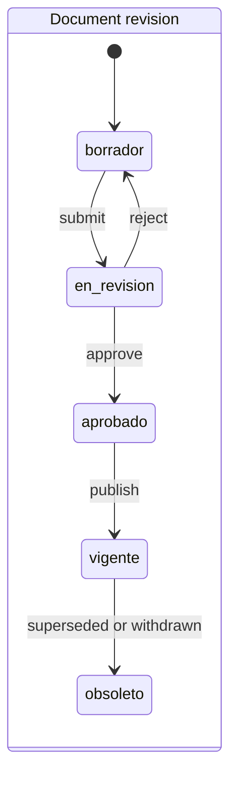
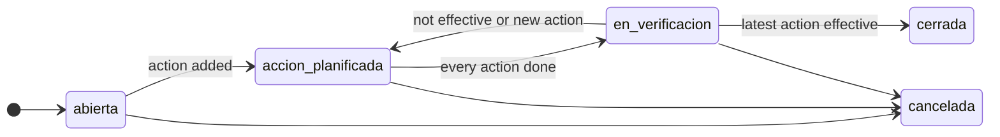
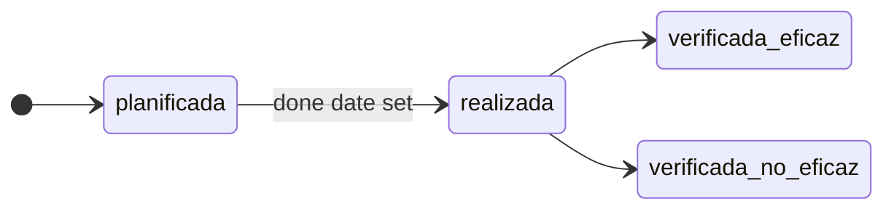

# ISO 9001 Gap Analysis of the QMS Application

This report assesses whether the application provides the documented information and process support that an organization needs to demonstrate each ISO 9001 requirement in a certification audit. It started as the input for the domain work behind the MCP server for AI agents, and now records what that work delivered and what remains.

- **Baseline (history):** first assessed read-only at `main@b794952` on 2026-10-02 and committed in `288558e`.
- **Re-assessed:** 2026-10-16, at `fd46fad` on the branch `docs/documentation-refresh`, whose application code matches `main`. Every clause row was assessed again.
- **Method:** a read-only review of the models, services, policy, routes, templates, MCP registry, reports and scheduled tasks. File and line references point to that commit. The behaviour is described in the [user guide](user-guide.md), the [service layer](architecture/services.md) and the [MCP server](mcp.md).
- **Framing:** software cannot comply with ISO 9001; the organization does. Each clause is judged on whether the app can hold the evidence and support the process.
- **Status:** Waves 0 and 1 of the roadmap are complete. Nine of the 34 clause rows are now covered, against none at the baseline.

## Summary

**At the baseline, no clause was fully covered.** The application was a set of independent CRUD registers. Records were not linked, versioned, approved or attributed to a person.

**At the re-assessment, the audit-critical clauses are covered:**

- documented information: 7.5.1, 7.5.2 and 7.5.3;
- competence: 7.2;
- quality objectives: 6.2;
- monitoring and measurement: 9.1.1;
- internal audit: 9.2;
- management review: 9.3;
- nonconformity and corrective action: 10.2.

Every record carries who created and last changed it, and an append-only audit log. People are records, not free text, wherever Wave 1 touched a register. What remains open are the planning and operational clauses, which still rest on unchanged text registers.

| Status | Clauses at the re-assessment | At the baseline |
|---|---|---|
| Covered | 9 (6.2, 7.2, 7.5.1, 7.5.2, 7.5.3, 9.1.1, 9.2, 9.3, 10.2) | 0 |
| Partial | 16 | 22 |
| Not covered | 6 (7.1.5, 7.1.6, 7.4, 8.3, 8.5, 8.6) | 8 |
| Documentary support only | 3 (4.1, 4.3, 5.1) | 4 |

The baseline column counts the original assessment. The previous version of this document showed one covered clause (9.3) because only that row had been updated.

These are the findings an auditor would most likely raise at the re-assessment:

1. **6.1 Risks and opportunities:** the register is a text list (type, description, plan). It has no scoring, owner, status, review date or link to actions, and no web screen. ISO 9001:2026 treats risks and opportunities as separate concepts.
2. **4.4 Processes:** a process holds a name, a quality criterion and a supplier flag. It has no owner, inputs, outputs, interactions or indicators, and no web screen.
3. **8.4 External providers:** the app holds only a boolean on the process and a nonconformity origin. There is no supplier register, approval or evaluation.
4. **6.3 Planning of changes:** only changes decided in a management review are tracked, as review actions of type `cambio_sgc`.
5. **4.1 and 4.3 Context and scope:** they can be held only as controlled documents. Nothing records internal and external issues, climate relevance or justified exclusions as data.
6. **8.2 and 9.1.2 Customers:** customers are free text, and complaints exist only as nonconformities with origin `cliente`. No review of customer requirements is recorded.

**Implication for the MCP work:**

- The MCP server shipped: 22 modules through five generic tools (`app/mcp_server/registry.py`, `_MODULES`). Each Wave 2 register adds one `Module` entry over its service.
- The five registers without web screens (roles, risks and opportunities, training resources, processes, audit indicators) are already MCP modules.

## Reference standard

**ISO 9001:2026 was published on 2026-09-16** and replaces ISO 9001:2015 with Amendment 1:2024. The AENOR store lists UNE-EN ISO 9001:2026. Certified organizations have a three-year transition, to about September 2029.

> **Note:** publication and transition data come from secondary sources (AFNOR, AENOR store, sector publications). `[VERIFY: confirm against iso.org and the UNE text before relying on exact clause wording.]`

The study used the 2015 + Amd 1:2024 clause structure. The 2026 edition keeps clauses 4 to 10, so the assessment remains valid. These 2026 changes affect the application and must be designed in from the start:

| Topic | Change | Impact on the app |
|---|---|---|
| Risks and opportunities (6.1) | Treated as separate concepts, with more weight on opportunities | Split `RiesgoOportunidad` into distinct risk and opportunity records (open) |
| Change management (6.3) | More planning, communication, monitoring and effectiveness review of QMS changes | `ChangeRecord` becomes a priority, not an optional extra (open) |
| Leadership (5.1) | Promote quality culture and ethical behaviour | Documentary support: evidence records and acknowledgements (open) |
| Climate change (4.1, 4.2) | Amendment 1:2024 folded into the main text | Climate relevance flag on context issues and stakeholder requirements (open) |
| Management review (9.3) | Inputs include changes in stakeholder needs | Delivered: the review inputs list the interested parties changed in the period (`app/services/management_reviews.py:727`, `_changed_parties`) |
| Documented information (7.5) | Wording moves from "maintain" to "available as documented information" | No model change expected |

## Verified defects

Each defect below was confirmed by reading the code.

- **Baseline defects:** the first two were reported by the September 2026 bug audit. Wave 0 fixed all three.
- **Open defects:** the last three were found while writing the user guides and are still open at the re-assessment.

| Defect | Location | Effect | Status |
|---|---|---|---|
| Monthly report counts all-time totals | `app/utils/reports.py:95-147`, `_monthly_report_context` | Counts now filter by the calendar month of `fecha` | Fixed |
| Satisfaction chart mixes years | `app/routes/dashboard_routes.py:87-96` | Now grouped by year and month over the last 12 months | Fixed |
| Any authenticated user can delete a nonconformity | `app/services/nonconformities.py:517-522`, `delete` | Now requires the delete grant, held only by ADMINISTRADOR (`app/services/policy.py:117`). The delete leaves an audit snapshot | Fixed |
| Dashboard shows audit data to every role | `app/routes/dashboard_routes.py:52-54` and `:112`; `app/templates/dashboard/dashboard.html:36-76` | OPERATIVO has no audit read access (`policy.py:125`) yet sees the audit count and the next seven days' audits with area and date. The card also lists cancelled and completed audits. Affects 7.5.3 and 9.2 | Open |
| Sign-in does not make the session permanent | `app/routes/auth_routes.py:61`, `login_user(user)`; `app/config.py:38`, `:44` | No `session.permanent` and no remember cookie, so the session cookie has no expiry date and `REMEMBER_COOKIE_DURATION` is unused. `PERMANENT_SESSION_LIFETIME` (8 h) only bounds the signed cookie's age since it was last written. Affects 7.5.3 | Open |
| Monthly report dated with the month's last day | `app/utils/reports.py:153`, `:159` (`generado=fecha`); `app/audit_notifications.py:118-123` | "Generado el" prints the last day of the reported month, not the date the report was produced. Affects 7.5.2 and 9.1.1 | Open |

## Clause-by-clause assessment

Legend:

- **C** covered: structured records hold the evidence and the services enforce the process.
- **P** partial: some structured support, or only free text the organization must fill in.
- **N** not covered.
- **D** documentary support only: the organization can keep a controlled document (7.5) but the app has no records for it.

"was X" marks a status that changed since the baseline. Paths are relative to `app/`.

| Clause | Status | Evidence | Gap |
|---|---|---|---|
| 4.1 Context | D | A context analysis can be a controlled document (`models.py:1102-1216`). Management review comment `comentario_contexto` (`models.py:1017`) | No register of internal and external issues, nor of climate relevance |
| 4.2 Interested parties | P | `ParteInteresada` (`models.py:94-100`) with web screens (`routes/parte_interesada_routes.py`) and the MCP module `partes_interesadas`. Parties changed in a review period are listed among the review inputs (`services/management_reviews.py:727`) | Needs, expectations and requirements are free text. No owner, review date, relevance flag or climate flag |
| 4.3 Scope | D | Scope and exclusions can be a controlled document. `ProgramaAuditoria.alcance` (`models.py:685`) is the audit scope, not the QMS scope | Scope, applicability and justified exclusions are not recorded as data |
| 4.4 Processes | P | `ProcesoOperacion` (`models.py:128-134`), reached through the JSON API only (`routes/proceso_operacion_routes.py:23`, `register_json_api`) and MCP. Objectives can name a process (`ObjetivoCalidad.proceso_id`, `models.py:863`) | No owner, inputs, outputs, interactions, criteria or indicators per process, and no web screen. Nonconformities and risks are not linked to processes |
| 5.1 Leadership | D | Management reviews record attendees, conclusions and actions (`RevisionDireccion`, `models.py:984-1044`). `RolResponsabilidad.compromiso_calidad` flag (`models.py:107`) | Nothing identifies top management. No evidence records for commitment, quality culture or ethics (2026) |
| 5.2 Quality policy | P | The policy can be a controlled document: numbered revisions, approval by someone other than the author, an effective date and history (`services/document_revisions.py:255-335`). Every role reads the revision in force (`services/policy.py:126`; `DRAFT_READERS`, `services/document_revisions.py:83`). Legacy free text `RolResponsabilidad.descripcion_politica_calidad` (`models.py:108`) | No record that people have read or acknowledged the policy. No quality-policy category (`DocumentCategory`, `models.py:1089-1100`). The policy is not available to external interested parties through the app |
| 5.3 Roles | P | People hold QMS roles (`persona_roles` and `Person`, `models.py:298-364`) with web screens (`routes/people_routes.py`). Roles carry competence requirements (`CompetenceRequirement`, `models.py:409-429`). A person may be linked to one login user (`Person.user_id`, `models.py:343`) | A role holds only a name, a flag and a policy text, not its responsibilities and authorities. Roles have no web screen (`routes/rol_responsabilidad_routes.py:23`, JSON and MCP only). Roles are not linked to processes |
| 6.1 Risks and opportunities | P | `RiesgoOportunidad` (`models.py:111-117`), JSON API and MCP only (`routes/riesgo_oportunidad_routes.py:23`). Risks changed in the period are listed among the review inputs (`services/management_reviews.py:739`). Review comment `comentario_riesgos` (`models.py:1020`) | No scoring, owner, status or review date. No link to actions, context or processes, and no web screen. Risks and opportunities share one record (2026 separates them) |
| 6.2 Quality objectives | **C** (was P) | `ObjetivoCalidad` (`models.py:835-886`) has title, indicator, unit, target and direction, baseline, owner, period, frequency, resources, evaluation method and state. Measurements are records of their own (`MedicionObjetivo`, `models.py:889-917`). The target is locked once measured, and progress, trend and overdue checks come from `services/quality_objectives.py` (`summary` at `:466`, `off_track` at `:519`). Every role reads the objectives (`services/policy.py:139`). Web screens, a yearly PDF (`routes/quality_objective_routes.py:234`) and a dashboard card | Minor: "what will be done" (6.2.2 a) is free text (`descripcion`), not tracked actions. No link to the policy or to risks |
| 6.3 Planning of changes | P (was N) | A management review can record a change to the QMS as an action of type `cambio_sgc` (`TipoAccionRevision`, `models.py:931-936`), with owner, deadline, state and result (`AccionRevision`, `models.py:1047-1086`) | No change register outside management reviews. No record of purpose, consequences, integrity, resources or the effectiveness of a change |
| 7.1 Resources | P | `RecursoCapacitacion` (`models.py:120-125`), JSON API and MCP only (`routes/recurso_capacitacion_routes.py:23`). People register (7.1.2, `Person`). Review comment `comentario_recursos` and actions of type `recursos` (`models.py:1019`, `:936`) | No infrastructure (7.1.3) or work-environment (7.1.4) records. The training-resources register has no type, owner or status, and no web screen |
| 7.1.5 Monitoring and measuring resources | N | None | No equipment register or calibration records |
| 7.1.6 Organizational knowledge | N | None | No knowledge register or lessons learned |
| 7.2 Competence | **C** (was P) | Required competence per role (`CompetenceRequirement`, `models.py:409-429`). Demonstrated competence per person, with evidence, expiry, training link and an effectiveness evaluation by another person (`CompetenceRecord`, `models.py:432-487`). Required-versus-demonstrated matrix (`services/competence.py:344`, `cell_status`; `:375`, `matrix`; page `routes/competence_routes.py:141`). Training is linked to a person (`Capacitacion.persona_id`, `models.py:634`) | Minor: evidence is text or a reference (500 characters), with no certificate upload. Roles, and therefore requirements, can only be created through the JSON API or MCP. The training's own `evaluacion_final` is free text |
| 7.3 Awareness | P (was D) | Every role reads the documents in force and the quality objectives (`services/policy.py:126`, `:139`). Awareness sessions can be recorded as training (`Capacitacion`) | No acknowledgement that a person has read the policy, the objectives or a procedure |
| 7.4 Communication | N | Only automated e-mails: audit reminders, document review alerts and the monthly report (`audit_notifications.py:55`, `:81`, `:112`, `:140`) | No communication plan: what, when, with whom, how and who communicates |
| 7.5.1 Documented information | **C** (was P) | Controlled documents (`Document`, `models.py:1102-1123`) with numbered revisions (`DocumentRevision`, `models.py:1153-1216`). Every register keeps who created and changed each record (`RecordMetadataMixin`, `models.py:57-90`), and an append-only audit log keeps the history (`AuditLog`, `models.py:1220-1258`) | None for the clause itself. The partial registers are assessed under their own clauses |
| 7.5.2 Creating and updating | **C** (was P) | Identification: code, title, category, revision number and author (`models.py:1113-1115`, `:1191`, `:1200`). A change summary is needed to submit (`models.py:1199`). Review and approval: submit, approve (ADMINISTRADOR, never the author) and reject with a reason (`services/document_revisions.py:255-299`). Format: text plus an optional PDF, DOCX, XLSX or ODT checked by content (`services/document_files.py:60-64`, `:155`) | None. See the open defect on the monthly report's date |
| 7.5.3 Control | **C** (was N) | One revision in force and one in preparation at most (`models.py:1140-1142`, `:1181-1184`). Publishing obsoletes the previous revision (`services/document_revisions.py:300`). Revisions in force or obsolete never change (`IMMUTABLE`, `:94`). Withdrawal instead of deletion (`:313`). Drafts are readable only by ADMINISTRADOR and AUDITOR (`:83`). Next review date and a weekly alert to owners (`services/documents.py:173`; `audit_notifications.py:140`). Attachment checksum (`models.py:1212`). Append-only audit log (`services/audit.py:183-190`) | No retention period or disposition record. No external-origin flag. Records of the older registers can still be hard-deleted by administrators (an audit snapshot remains). No screen to read the audit log. The two open access defects (dashboard, session) |
| 8.1 Operational planning | P | `ProcesoOperacion.criterio_calidad` (`models.py:132`), JSON API and MCP only | No operational plan or acceptance criteria per process, and no web screen |
| 8.2 Requirements for products and services | P | Customer feedback in `SatisfaccionCliente` (`models.py:619-625`). Complaints can be recorded as nonconformities with origin `cliente` (`OrigenNoConformidad`, `models.py:508`) | No review of customer requirements, no change record or communication log, and no complaint register with the answer to the customer |
| 8.3 Design and development | N | None | No design entity; may be excluded only if the organization justifies it |
| 8.4 External providers | P | `ProcesoOperacion.control_proveedor` boolean (`models.py:133`). Nonconformity origin `proveedor` (`models.py:510`). Review comment on performance including external providers (`comentario_desempeno`, `models.py:1018`) | No supplier register, approval, evaluation or re-evaluation |
| 8.5 Production and service provision | N | None | No control, traceability, customer property or post-delivery records |
| 8.6 Release | N | None | No release record |
| 8.7 Nonconforming outputs | P | `NoConformidad` (`models.py:523-542`) with origin, severity, containment (`contencion`), owner (`responsable_id`) and root cause, and corrective actions (10.2) | No disposition (correction, segregation, return, concession), no concession or deciding-authority record, and no link to the product, lot or process |
| 9.1.1 Monitoring and measurement | **C** (was P) | Indicators are records: each objective defines what is measured, how often and how results are evaluated (`models.py:864-877`). Dated measurements (`models.py:889-917`) are judged against the target, with trend and overdue checks (`services/quality_objectives.py:466`). The monthly report counts the month and judges the objectives (`utils/reports.py:66`, `:95-147`) | Minor: process indicators without a target must be entered as objectives. The legacy audit-indicators register (`AuditoriaIndicador`, `models.py:137-144`) is JSON and MCP only (`routes/auditoria_indicador_routes.py:23`). See the open defect on the report's date |
| 9.1.2 Customer satisfaction | P | `SatisfaccionCliente` (`models.py:619-625`) with web screens (`routes/satisfaccion_cliente_routes.py`) and a PDF. Period average among the review inputs (`services/management_reviews.py:753`). Monthly chart (`routes/dashboard_routes.py:87-96`) | The customer is free text. No survey type, channel or target |
| 9.1.3 Analysis and evaluation | P | Objective versus target and trend (`services/quality_objectives.py:466`, `:519`). Period-bound review inputs: satisfaction, objectives, indicators, nonconformities, audits, improvements and training (`services/management_reviews.py:595`, `:665-684`). Monthly report | No analysis of supplier performance (9.1.3 f) or of the effectiveness of actions on risks (9.1.3 e), because neither has records |
| 9.2 Internal audit | **C** (was P) | Yearly programme with objectives and scope, approved by an administrator (`ProgramaAuditoria`, `models.py:662-696`; `services/audit_programmes.py:187`). Each audit has programme, scope, criteria, lead auditor, team and area owner (`Auditoria` and `auditoria_equipo`, `models.py:701-762`). Independence check: no auditor owns the audited area (`services/audits.py:226-251`). Findings are classified and a nonconformity finding opens its nonconformity (`HallazgoAuditoria`, `models.py:765-807`; `services/audit_findings.py:277`). Audit and programme PDFs (`routes/auditoria_routes.py:306`; `routes/audit_programme_routes.py:139`). Reminders (`audit_notifications.py:55`, `:81`) | Minor: the audit report is free text (`resultado`), and `accion_correctiva` is legacy free text. No audit frequency or method per process. See the open dashboard defect |
| 9.3 Management review | C | Each review records meeting date, period, attendees, a comment per input of 9.3.2 and conclusions (`RevisionDireccion`, `models.py:984-1044`). The inputs are drawn from the registers and frozen when the review is held (`services/management_reviews.py:595`, `inputs`; `:355`, `hold`). Each output is an action with owner, deadline and follow-up (`AccionRevision`, `models.py:1047-1086`). Minutes PDF (`routes/management_review_routes.py:310`) and an overdue-actions card | None |
| 10.1 Improvement | P | `Mejora` (`models.py:147-153`) with web screens (`routes/mejora_routes.py`). Opportunities also come from audit findings of type `oportunidad_mejora` and review actions of type `mejora` (`models.py:771`, `:934`) | Improvements are a free-text list that requires a nonconformity text (`forms.py:172-176`). No pipeline and no link to their source. Opportunities live in three unconnected places |
| 10.2 Nonconformity and corrective action | **C** (was P) | `NoConformidad` (`models.py:490-542`) has origin, severity, containment, root cause, owner and a state set only by the service. Corrective actions have owner, due date, done date and verification by someone other than the owner (`AccionCorrectiva`, `models.py:545-616`; `services/corrective_actions.py:231`, `verify`). A nonconformity closes only after its latest action proves effective (`services/nonconformities.py:378`, `close`; `:450`, `close_blockers`). Cancel and reopen with a reason; PDF (`routes/no_conformidad_routes.py:210`) | Minor: no link to risks (10.2.1 e) or to QMS changes (10.2.1 f), and no record of similar nonconformities. The legacy free-text `accion_correctiva` is still editable on the form (`forms.py:143`) |
| 10.3 Continual improvement | P | `Mejora` (`models.py:147-153`). Objective trends (`services/quality_objectives.py:466`). Review conclusions and improvement actions (`models.py:1022`, `:934`) | `fecha_implementacion` is always the creation time (`models.py:153`; not on the form). Improvements are not linked to objectives or review outputs |

## Top 10 gaps by audit impact

The baseline's first seven gaps were closed by Wave 1:

- uncontrolled documents;
- no management review;
- the open corrective-action loop;
- no audit programme;
- unmeasurable objectives;
- no attribution or history;
- people as free text.

These are the remaining ten.

| # | Gap | Clause | Why an auditor flags it | Domain change |
|---|---|---|---|---|
| 1 | Risks and opportunities unstructured | 6.1 | A mandatory planning clause, changed in 2026, with no scoring, owner, status, review or actions | Separate risk and opportunity records with scoring, owner, review date and links to actions, processes and context; web screens |
| 2 | Processes and roles not defined | 4.4, 8.1, 5.3 | No process owner, inputs, outputs or interactions. Roles hold no responsibilities or authorities. Neither has a web screen | Owner, inputs, outputs, interactions and criteria on `ProcesoOperacion`; responsibilities and authorities on roles; screens; nonconformities, risks and objectives linked to processes |
| 3 | No supplier control | 8.4 | Only a boolean and a nonconformity origin | `Supplier`, `SupplierEvaluation`, approved-supplier status, links from nonconformities with origin `proveedor` |
| 4 | Context and scope not recorded | 4.1, 4.2, 4.3 | Issues, climate relevance, stakeholder requirements and exclusions exist at most in a document | `ContextIssue` with a climate flag, `InterestedPartyRequirement`, a scope and exclusions record, all feeding the review inputs |
| 5 | No change register | 6.3 | Emphasised in 2026; only review actions of type `cambio_sgc` | `ChangeRecord` with purpose, consequences, resources, owner and an effectiveness review |
| 6 | Customers free text, complaints only as nonconformities | 8.2, 9.1.2 | The same customer appears under several spellings; no complaint handling or requirement review | `Customer`, `Complaint` with an optional link to a nonconformity, survey type and channel |
| 7 | Nonconforming outputs without disposition | 8.7 | No disposition, concession or deciding authority; no product or process link | Disposition, concession and authority on `NoConformidad`, plus a process link |
| 8 | No calibration register | 7.1.5 | Required wherever measurement results are used | `MeasuringEquipment`, `CalibrationRecord` |
| 9 | Policy and objectives not acknowledged | 5.2, 7.3 | Awareness rests on interviews only | Acknowledgements of the policy revision in force and of the objectives |
| 10 | No communication plan or knowledge register | 7.4, 7.1.6 | Nothing records what is communicated to whom, or the lessons learned | `CommunicationPlan`, a knowledge or lessons-learned register |

## Cross-cutting gaps

- **Links still missing.**
  - Delivered: nonconformity → corrective action → effectiveness; audit finding → nonconformity; objective → process; review → actions.
  - Still missing: risk → action; complaint → nonconformity; nonconformity → process; improvement → its source.
  - Customers and suppliers remain free text.
- **No complaint handling.** Complaints exist only as nonconformities with origin `cliente`, beside the satisfaction surveys.
- **Coarse roles.**
  - Access follows a per-resource matrix (`services/policy.py:117-141`) over three roles.
  - No role separates approvers or top management. Approvals rest on ADMINISTRADOR, with "never the author" for documents (`services/document_revisions.py:266-286`).
  - The dashboard bypasses the matrix for audits (see "Verified defects").
- **The audit log cannot be read in the app.** Every model is audited (`services/audit.py:45`, `AUDITED_MODELS`) and rows are append-only (`:183-190`). However, the log has a policy entry only (`policy.py:133`): no screen and no MCP module. History must be shown to an auditor from the database.
- **Five registers without web screens.**
  - The registers: roles (5.3), risks and opportunities (6.1), processes (4.4, 8.1), training resources (7.1, 7.2) and audit indicators (9.1).
  - They are reachable only through the JSON endpoints (`routes/json_register.py:32`, `register_json_api`) and the MCP server.
  - People, competence requirements and objectives already pick from roles and processes.
- **Hard deletes remain** for the older registers. They are limited to administrators and leave a full audit snapshot, but they erase the record itself.

## Target domain model

This was the baseline proposal. The status column records what Waves 0 and 1 delivered; field names stay indicative for the open entities.

### Existing entities to change

| Entity | Changes | At the re-assessment |
|---|---|---|
| `User` | Link to `Person`; `active`, `last_login` | Done except `last_login`: `Person.user_id` (`models.py:343`), `User.active` (`models.py:164`) |
| `Document` | `status`, `owner_id`, `next_review_date`, `retention_until`; content and files move to `DocumentRevision`; `approved_by` becomes a foreign key | Done except `retention_until`: the status lives on the revisions; `owner_id`, `next_review_date`, `approver_id` |
| `NoConformidad` | `source`, `process_id`, `severity`, `containment`, `disposition`, `responsible_id`, `root_cause`, `created_by`, `closed_by`; `estado` becomes an enum with transitions | Done except `process_id`, `disposition` and `closed_by` (closing is recorded in the audit log) |
| `Auditoria` | `programme_id`, `scope`, `criteria`, `lead_auditor_id`, audit team, report | Done except a structured report (`resultado` stays free text) |
| `Mejora` | Becomes an improvement opportunity linked to its source | Open |
| `Capacitacion` | Link to `Person` and `CompetenceRequirement`; effectiveness result | Done: `persona_id`; `CompetenceRecord.capacitacion_id` links it as evidence and holds the effectiveness evaluation |
| `SatisfaccionCliente` | Link to `Customer`; `survey_type`, `channel` | Open |
| `RiesgoOportunidad` | Split into risk and opportunity; `probability`, `severity`, `level`, `owner_id`, `status`, `review_date`, links to context, process and action | Open |
| `ProcesoOperacion` | `owner_id`, inputs, outputs, indicators | Open (objectives already link to processes) |
| `AuditoriaIndicador` | Merge into `Auditoria` or turn into an indicator entity | Open; quality objectives now serve as indicators |

### New entities

| Entity | Purpose | Clause | At the re-assessment |
|---|---|---|---|
| `AuditLog` | Entity, action, user, channel (web or MCP), timestamp, before and after | Cross-cutting | Delivered |
| `Person`, `Customer`, `Supplier` | Replace free-text names | 5.3, 7.2, 8.4, 9.1.2 | `Person` delivered; `Customer` and `Supplier` open |
| `DocumentRevision` | Versioned content or file, approval data | 7.5.3 | Delivered |
| `CorrectiveAction` | Owner, due date, status, effectiveness result | 10.2 | Delivered as `AccionCorrectiva` |
| `QualityObjective`, `ObjectiveMeasurement` | Target, unit, owner, deadline, periodic values | 6.2 | Delivered as `ObjetivoCalidad`, `MedicionObjetivo` |
| `AuditProgramme`, `AuditFinding` | Yearly programme; findings classified as major NC, minor NC, observation or opportunity | 9.2 | Delivered as `ProgramaAuditoria`, `HallazgoAuditoria` |
| `ManagementReview`, `ReviewInput`, `ReviewOutput` | Period-bound inputs, decisions and follow-up actions | 9.3 | Delivered as `RevisionDireccion` (inputs frozen in `datos_entrada`) and `AccionRevision` |
| `Complaint` | Customer complaint with optional link to a nonconformity | 9.1.2, 10.2 | Open |
| `SupplierEvaluation` | Periodic score and result | 8.4 | Open |
| `MeasuringEquipment`, `CalibrationRecord` | Equipment status and next due date | 7.1.5 | Open |
| `ContextIssue`, `InterestedPartyRequirement` | Context and stakeholder requirements with climate flag | 4.1, 4.2 | Open |
| `Action` | Generic action for risks, objectives and review outputs | 6.1, 9.3 | Open; corrective and review actions are separate entities |
| `ChangeRecord` | Planned QMS changes with impact and owner | 6.3 | Open |
| `CompetenceRequirement`, `CommunicationPlan` | Competence per role; what, when, to whom and how | 7.2, 7.4 | `CompetenceRequirement` delivered, with `CompetenceRecord`; `CommunicationPlan` open |

### Key state machines (as delivered)

A revision moves from draft through review and approval to in force (`EstadoRevision`, `models.py:1126-1137`). It becomes obsolete when the next revision is published or the document is withdrawn. A rejection returns it to draft with the reason. Revisions in force or obsolete never change.

While open, a nonconformity follows its corrective actions (`services/nonconformities.py:431`, `expected_state`).

- **Closing** needs every action done and verified, and the latest one effective.
- **Cancelling** needs a reason.
- **Reopening** (administrators) returns a closed or cancelled nonconformity to the state its actions call for.

A corrective action's state is derived from its dates and verification, never stored (`AccionCorrectiva.estado`, `models.py:607-616`). An ineffective verification calls for a new action.

## Strengths to preserve

- **Security work:**
  - strict CSP (`app/__init__.py:184`);
  - single-use reset tokens bound to the password state (`models.py:177-291`);
  - CLI-only administrator bootstrap (`commands.py:56-111`);
  - the security logger.
- **One service layer and one policy** for the web and the MCP server (`services/policy.py:117-158`). A test keeps routes from writing models directly (`tests/test_route_write_guard.py`).
- **Attribution and an append-only audit log** on every model (`models.py:57-90`; `services/audit.py:45-54`, `:183-190`).
- **Rules held by the database:** CHECK constraints and partial unique indexes back the state rules (`models.py:950-963`, `:1140-1150`, `:1181-1186`).
- **Themed PDFs** for nonconformities, audits, programmes, training, surveys, objectives and review minutes, which are ready-made audit evidence.
- **Celery scheduling** with per-recipient failure isolation (`audit_notifications.py:238-260`) and the local date in `APP_TIMEZONE` (`audit_notifications.py:50`, `local_today`).

## Proposed roadmap

Each wave adds MCP tools for the modules it completes, on top of the shared service layer.

| Wave | Scope | MCP outcome |
|---|---|---|
| 0. Foundations (**complete**) | Service layer, `AuditLog` and record metadata, `Person`, permission policy, API tokens, the three baseline defects | Token authentication and tools for the existing registers |
| 1. Audit-critical (**complete**) | Document control, nonconformity → corrective action → effectiveness, audit programme and findings, quality objectives, management review; people and competence | Read and write tools for these modules, no delete tools (22 modules) |
| 2. Core QMS (proposed below) | Risks and opportunities, processes and roles, suppliers, context and scope, change management, customers and complaints, nonconforming-output disposition, acknowledgements, improvements | One registry module per register as delivered |
| 3. Organization-dependent | Calibration, design and development, production and release, communication, organizational knowledge | Only for modules the organization does not exclude |

**Before Wave 2:** fix the three open defects (the dashboard's audit card, the session lifetime and the monthly report's date). They are small and independent of the domain work.

**Wave 2, ordered by audit impact:**

| # | Module | Clauses | Why at this place |
|---|---|---|---|
| 1 | Risks and opportunities | 6.1 (also 9.3.2 e, 10.2.1 e) | Mandatory and changed in 2026. Today a text list with no scoring, owner, status or screen, which corrective actions and reviews cannot cite |
| 2 | Processes, roles and the other JSON registers | 4.4, 8.1, 5.3, 7.1, 9.1 | The process approach underpins every audit trail. Objectives, people and competence already depend on processes and roles, which have no screens. Includes screens for training resources, and screens or retirement for audit indicators |
| 3 | External providers | 8.4 | A frequent certification finding; only a boolean and a nonconformity origin exist |
| 4 | Context, interested-party requirements and scope | 4.1, 4.2, 4.3 | 2026 climate relevance. A controlled document covers it meanwhile, which is why it ranks below suppliers |
| 5 | Planning of changes | 6.3 | Emphasised in 2026; review actions of type `cambio_sgc` cover part of it meanwhile |
| 6 | Customers and complaints | 8.2, 9.1.2 | Customers are free text. Complaints are handled meanwhile as nonconformities with origin `cliente` |
| 7 | Nonconforming outputs | 8.7 | Disposition, concession and authority on the nonconformity; its process link comes from item 2 |
| 8 | Acknowledgements | 5.2, 7.3 | Read confirmations of the policy in force and of the objectives; awareness otherwise rests on interviews |
| 9 | Improvement register | 10.1, 10.3 | Unifies improvements, finding opportunities and review actions with their source and a real implementation date |

## Limits of this study

- Clause requirements are paraphrased; the standard is not quoted.
- References point to the code at `fd46fad`. The baseline references (at `b794952`) are superseded. All six defects above were confirmed by reading the code.
- "Covered" means the application holds the evidence and supports the process. Whether the organization operates it is for the audit.
- Statuses come from the code, not from production data.
- Whether 7.1.5, 8.3, 8.5 and 8.6 apply depends on the organization's activity and justified exclusions.
